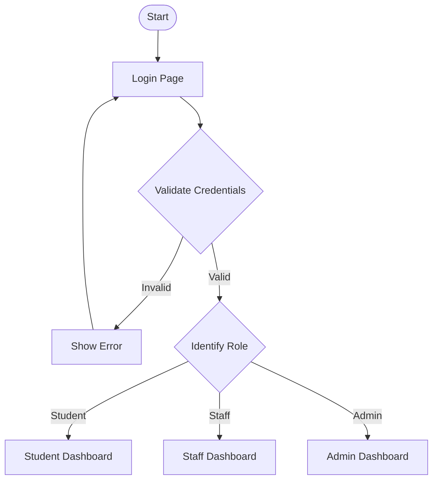
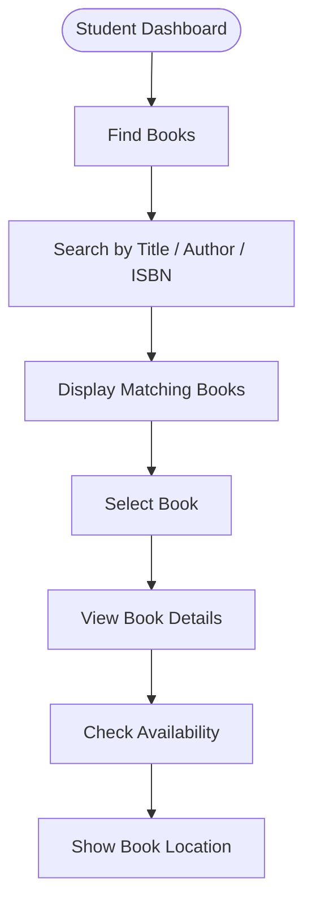
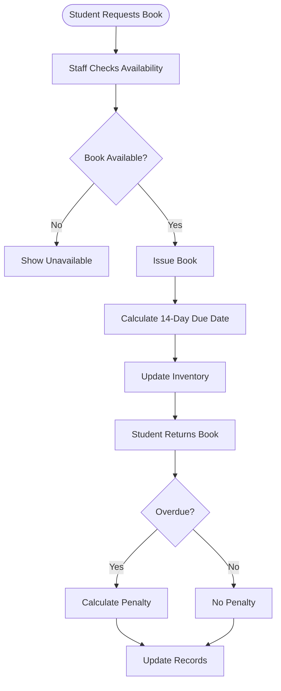
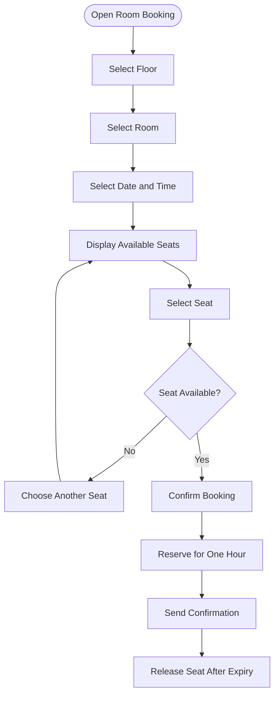
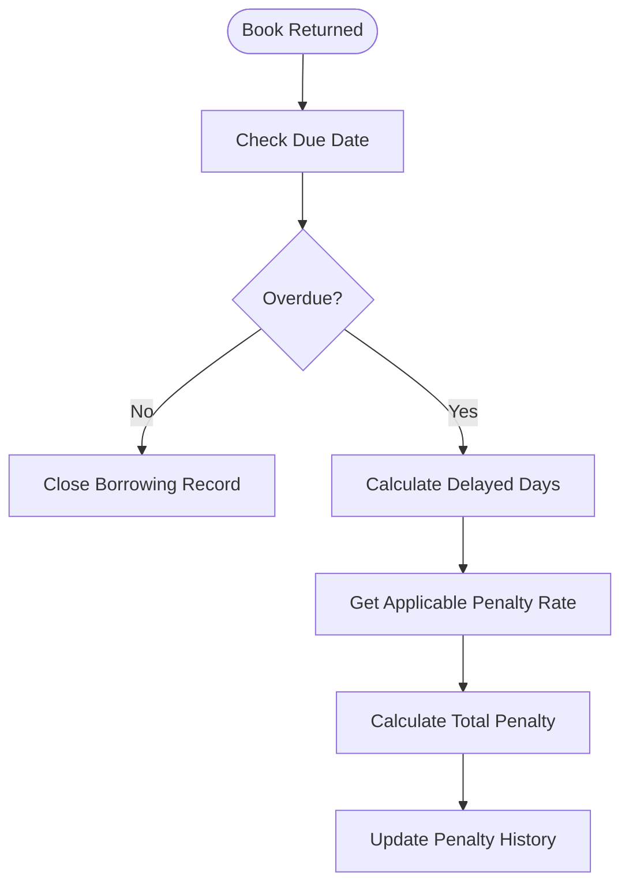

# 📚 Smart University Library Management System

A modern, web-based university library management prototype designed to simplify library operations through a centralized platform with separate dashboards for Students, Staff, and Administrators.

---

## 📌 Project Summary

The Smart University Library Management System aims to digitize and improve traditional university library operations.

Students can search for books, check availability, locate books using an interactive library map, reserve study-room seats, track borrowed books, and view penalties.

Library staff can manage book issuing and returns, monitor reservations, maintain student records, and manage overdue books.

Administrators can manage users, books, library facilities, room configurations, penalty settings, announcements, and reports.

The project demonstrates an integrated library management solution using modern frontend technologies and LocalStorage for prototype data persistence.

## 🎯 Project Objectives

- Simplify book searching and borrowing.
- Provide interactive book-location navigation.
- Display library seating availability.
- Enable study-room reservations.
- Automate book due-date calculations.
- Calculate overdue penalties.
- Provide role-based dashboards.
- Improve library management and monitoring.

## ✨ Key Features

### 🔐 1. Role-Based Authentication

Three user roles with separate dashboards.

| Role | Demo User ID | Password |
|---|---|---|
| Student | `User1` | `User@1234` |
| Staff | `Staff1` | `Staff@1234` |
| Admin | `Admin1` | `Admin@1234` |

Features:
- Common login page.
- Automatic role-based redirection.
- Form validation.
- Show/hide password.
- Session persistence.
- Logout functionality.

### 📚 2. Book Management

- Search by title, author, ISBN, and category.
- Filter books by availability.
- View complete book details.
- Track available and issued copies.
- Display floor, section, rack, and shelf.
- Recently added books.

**Book availability indicators:**

- 🟢 Available
- 🔵 Issued
- 🟠 Reserved
- 🔴 Overdue

### 🗺️ 3. Interactive Library Map

- Floor-wise navigation.
- Interactive sections and racks.
- Shelf identification.
- Book-location highlighting.
- Search-to-location functionality.

Note: The map represents a prototype layout, not a verified official university floor plan.

### 📅 4. Book Issue and Return

- Staff can issue books to students.
- Automatic issue-date recording.
- Automatic due-date calculation.
- Maximum borrowing period of 14 days.
- Inventory updates.
- Book return processing.
- Overdue detection.
- Borrowing history.

### 🏢 5. Study Room Booking

Students can reserve dedicated study rooms.

**Room configuration:**

| Configuration | Quantity |
|---|---:|
| Floors | 4 |
| Rooms per floor | 6 |
| Seats per room | 8 |
| Total rooms | 24 |
| Total dedicated seats | 192 |

**Booking features:**

- Select floor, room, and seat.
- Choose booking date and start time.
- Automatic one-hour booking duration.
- Prevent overlapping seat reservations.
- Cancel reservations.
- View booking history.
- Automatically release expired reservations.

**Example booking:**

| Detail | Value |
|---|---|
| Floor | 4 |
| Room | 3 |
| Seat | S5 |
| Start | 10:00 AM |
| End | 11:00 AM |
| Duration | 1 Hour |

**Seat indicators:**

- 🟢 Available
- 🔴 Booked
- 🔵 Selected
- ⚪ Temporarily unavailable

### 🪑 6. General Library Seat Availability

- Floor-wise seat availability.
- Total, occupied, and available seats.
- Visual seating layout.
- Occupancy percentage.
- Prototype availability updates.

General library seating is separate from dedicated study-room seats.

### 🔔 7. Notification Management

Notifications for:

- Book due-date reminders.
- Overdue alerts.
- Book reservation confirmations.
- Seat reservation confirmations.
- Study-room booking confirmations.
- Booking expiry reminders.
- Library announcements.

Additional features:

- Read/unread status.
- Unread notification count.
- Timestamps.
- Clear notifications.

### 💰 8. Penalty Management

Automatic overdue penalty calculation.

**Formula:**

```text
Penalty = Delayed Days × Daily Penalty Rate
```

**Example:**

```text
Due Date: November 15
Return Date: November 20
Delayed Days: 5
Daily Penalty: ₹5

Total Penalty = 5 × ₹5 = ₹25
```

Penalty configuration:

- Default penalty rate.
- Category-wise penalty rates.
- Individual book penalty rates.
- Overdue records.
- Student-wise penalty history.
- Pending and resolved penalty records.

**Penalty priority:**

1. Individual book penalty.
2. Category penalty.
3. Default penalty.

Administrators can configure penalty rates, while staff can manage penalty records.

### 👨‍💼 9. Staff Dashboard

- Search student records.
- View borrowing history.
- Issue books.
- Process returns.
- Manage book reservations.
- Monitor room and seat occupancy.
- View overdue records.
- Manage penalty records.
- Send notifications.

### 🛡️ 10. Admin Dashboard

- Manage students and staff.
- Add, edit, and delete books.
- Manage book categories.
- Configure library floors and sections.
- Manage rooms and seating.
- Configure penalty rates.
- Monitor overdue records.
- View reports and analytics.
- Manage announcements.
- View library statistics.

---

## 🔄 Project Workflow

### 1. Authentication Workflow



### 2. Book Search Workflow



### 3. Book Issue and Return Workflow



### 4. Study Room Booking Workflow



### 5. Penalty Calculation Workflow



---

## 📄 Application Pages

| Section | Pages |
|---|---|
| Common | Login, Profile, Notifications |
| Student | Dashboard, Find Books, Book Details, Library Map, Seat Availability, Room Booking, My Books, Borrowing History, My Penalties |
| Staff | Dashboard, Student Records, Issue Books, Return Books, Book Reservations, Overdue Management, Seat and Room Monitoring |
| Admin | Dashboard, User Management, Book Management, Category Management, Floor Management, Room Management, Seating Management, Penalty Configuration, Reports and Analytics, Announcement Management, Library Settings |

## 🛠️ Technology Stack

| Technology | Purpose |
|---|---|
| Next.js | Frontend framework |
| React.js | UI development |
| TypeScript | Type safety |
| Tailwind CSS | Styling |
| Lucide React | Icons |
| Framer Motion | Animations |
| Recharts | Data visualization |
| LocalStorage | Prototype data persistence |
| React Context | State management |

## 🚀 Getting Started

### Prerequisites

- Node.js
- npm
- Git

### Installation

**1. Clone the repository**

```bash
git clone https://github.com/YOUR_USERNAME/Library_System_Management_Prototype.git
```

**2. Navigate to the project directory**

```bash
cd Library_System_Management_Prototype
```

**3. Install dependencies**

```bash
npm install
```

**4. Start the development server**

```bash
npm run dev
```

**5. Open in your browser**

```text
http://localhost:3000
```

---

## 📁 Suggested Project Structure

```text
Library_System_Management_Prototype/
│
├── public/
│   ├── images/
│   └── icons/
│
├── src/
│   ├── app/
│   │   ├── login/
│   │   ├── student/
│   │   ├── staff/
│   │   ├── admin/
│   │   ├── books/
│   │   ├── rooms/
│   │   ├── seats/
│   │   └── notifications/
│   │
│   ├── components/
│   ├── context/
│   ├── hooks/
│   ├── lib/
│   ├── types/
│   └── data/
│
├── public/
├── README.md
└── package.json
```

## 🧪 Testing Checklist

- [ ] Student, Staff, and Admin login.
- [ ] Role-based access control.
- [ ] Book search and filtering.
- [ ] Book issue and return.
- [ ] Automatic 14-day due-date calculation.
- [ ] Overdue detection.
- [ ] Penalty calculation.
- [ ] Individual book penalty configuration.
- [ ] Room and seat selection.
- [ ] One-hour booking validation.
- [ ] Duplicate booking prevention.
- [ ] Automatic booking expiry.
- [ ] Notification functionality.
- [ ] LocalStorage persistence.
- [ ] Responsive design.

## ⚠️ Prototype Limitations

- Uses sample/mock data.
- Uses LocalStorage for data persistence.
- Authentication is for demonstration only.
- Notifications are simulated in-app.
- No real payment gateway.
- No live university database integration.
- Library map is a prototype layout.

A production version would require secure backend authentication, database integration, server-side authorization, and appropriate data protection.

## 🔮 Future Enhancements

- Backend integration using Node.js or FastAPI.
- Database integration using PostgreSQL or Supabase.
- Secure authentication and authorization.
- QR-code-based book issue and return.
- Real-time seat availability.
- Email and push notifications.
- Online penalty payment integration.
- AI-powered book recommendations.
- Advanced library analytics.

---

## 👨‍💻 Project Information

**Project:** Smart University Library Management System

**Domain:** Education / Library Management

**Type:** Web Application Prototype

**Purpose:** To make university library management smarter, faster, and more accessible through technology.

---

**📚 Built with ❤️ using Next.js, React, and TypeScript.**
